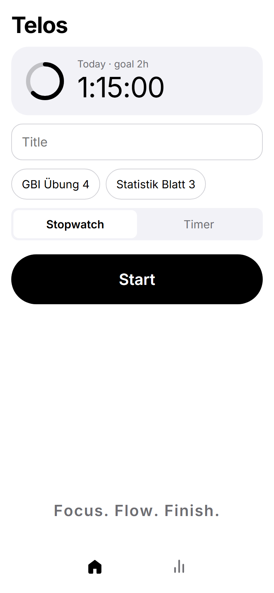
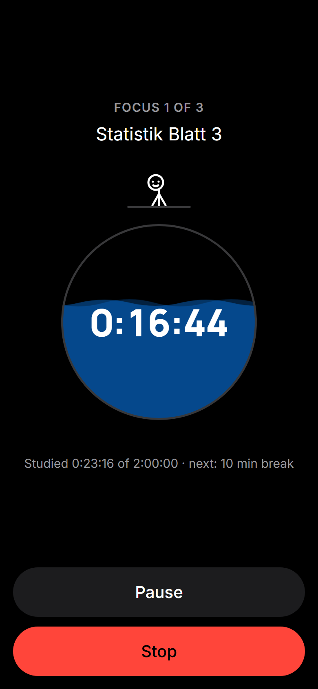
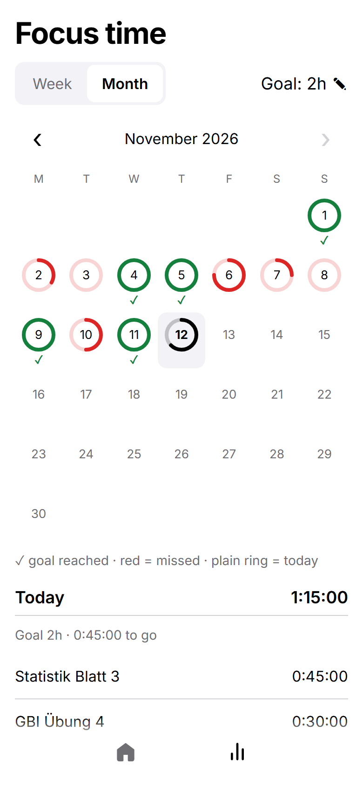
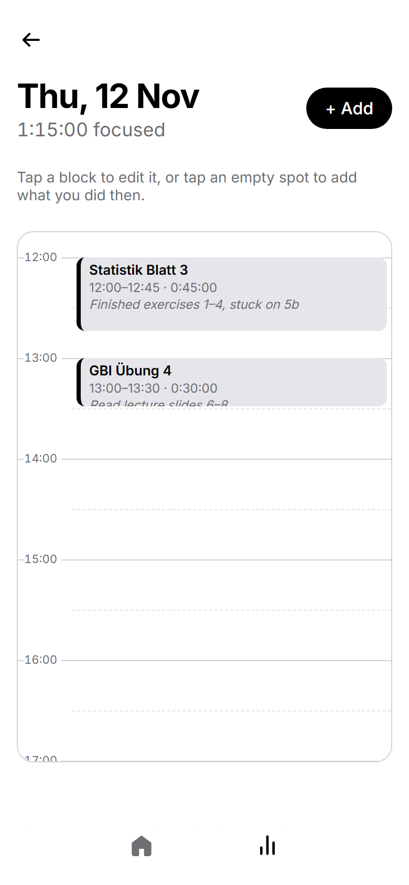
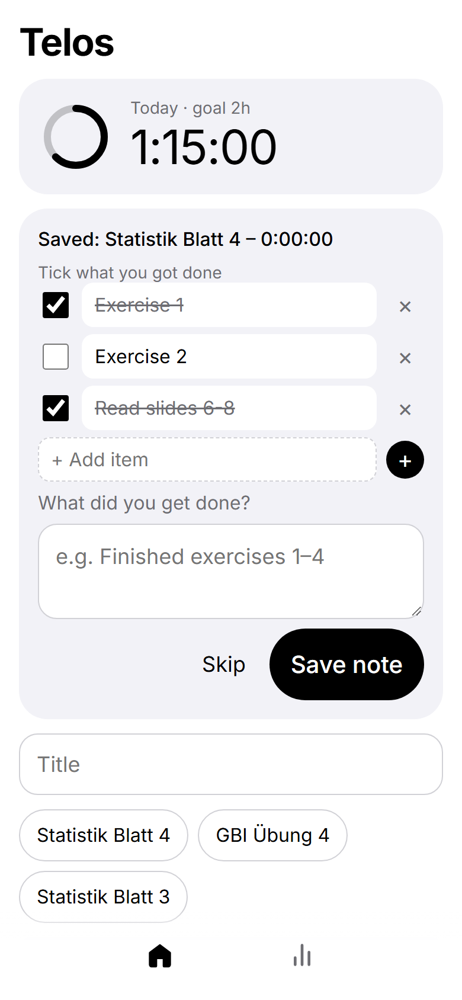
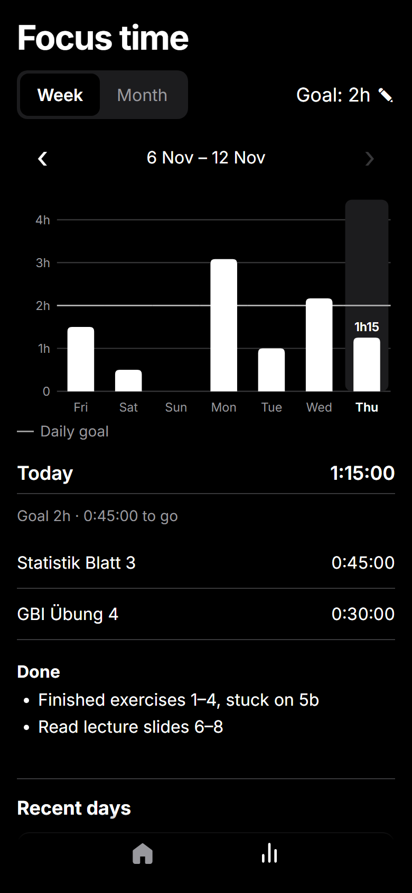

# Telos

**A phone-first study timer that answers one question honestly: _"What did I actually work on today, and for how long?"_**

Telos (Greek *τέλος*: the goal, the end you work towards) is an installable, offline-first web app for tracking focused study time. It has a stopwatch, and a timer that plans breaks for you. Each day shows up as a calendar of what you did, a daily goal tracks your progress, and a checklist lets you tick off what you got done.

**▶ Live app:** https://adrinleon22-alt.github.io/focus-app/
Open it on a phone and choose *Add to Home screen* / *Install app*. It then runs full screen and works in airplane mode.

| Home | Timer | Month & goals |
|:---:|:---:|:---:|
|  |  |  |
| **Day timeline** | **Checklist at the end** | **Week (dark mode)** |
|  |  |  |

---

## Why I built it

Study apps either track too little ("you studied 3 h") or ask for too much (accounts, projects, tags). I wanted something I would actually open every day on my phone. That meant one big Start button, no sign-up, and data that stays on my device. At the end of a day it should tell me exactly *which* tasks took *how long*, and whether I hit my goal.

## Features

- **Stopwatch or Timer.** For the timer you enter your study time (e.g. 120 min), pick from a few break plans (one is marked *recommended*), and the app runs focus blocks and breaks automatically. It beeps and vibrates at each switch and keeps the screen on.
- **Every focus block is saved as its own session**, so the day view shows the real rhythm of your work, breaks included.
- **Calendar-style day view.** Sessions appear as blocks at their real times, and overlapping ones sit side by side. Tap an empty spot to add something you forgot to time.
- **Daily goal with history.** A month calendar shows a progress ring per day: green with ✓ when the goal was reached, red when missed. Changing the goal never rewrites the past.
- **Checklists and notes.** Tap the 💡 next to the title to plan a checklist, then tick it off when the session ends.
- **Edit anything.** Forgot to stop the timer? Fix the times; the totals update everywhere.
- **Backup.** Export and import all data as JSON. Import *merges* by id, so it never loses data and importing twice is harmless.
- **Installable and offline** (PWA). Light and dark mode follow the phone, and the Android back gesture works between screens.
- **Small delights:** an opening screen with the app icon and a typewriter intro (*τέλος* → *Telos*) that zooms out into the app, an egg-shaped water dial that fills to the brim, a stick figure who peeks, gasps when you pause and salutes when you stop, and "bubbly" buttons.

## Tech stack

**Plain HTML, CSS and JavaScript, with no framework and no build step.** It's hosted on GitHub Pages and data lives in `localStorage`.

| File | Role |
|---|---|
| `index.html` | All screens (Home, Timer, Stats, Day, Edit, …). Only one is visible at a time. |
| `style.css` | Design tokens (light/dark), components and animations |
| `app.js` | All logic, in labelled sections: storage, timer engine, totals, screens, checklists, stats, backup |
| `sw.js` | Service worker: offline support |
| `manifest.json`, `icons/` | Install as an app |
| `fonts/` | Self-hosted Inter and Manrope (OFL licence files included) |

## Key decisions & why

| Decision | Why |
|---|---|
| **No framework, no build step** | The app is small, and every line is readable in the browser's dev tools. Nothing to install or keep updated, and the whole app loads in one request per file. |
| **Time is computed from timestamps, never counted** (`now − start − paused`) | Phones freeze JavaScript when the screen is off. A `seconds++` counter would drift. Timestamps stay correct through sleep, closing the app and reloading. The running session is saved on every start, pause and resume. |
| **The timer catches up after sleep** | When you come back, the engine walks through every phase that ended in the meantime and saves each finished block with its *real* start and end. A 2-hour plan with the phone asleep for an hour still produces three correct blocks. |
| **Days use the local date; a session counts for the day it started** | UTC would put a 00:30 Berlin session on the wrong day. Splitting sessions at midnight was considered, but it makes one session appear on two days. |
| **The goal is stored as a history** (`[{from, minutes}]`) | Raising the goal today shouldn't turn last week's "reached" days red. Each day is judged by the goal that applied *on that day*. |
| **Import merges by id instead of replacing** | Importing an old backup by mistake can never wipe newer data. The trade-off (a deleted session can come back from an old file) is the safer failure. |
| **Network-first service worker** (with a 3 s fallback to the cache) | The first version served the cached copy first. During development that produced a mix of new HTML and old JS, and a feature "didn't work" on the phone. Network-first always loads one consistent version when online and still works offline. |
| **Self-hosted fonts** | Offline use and privacy: no request to a font CDN. Only the needed character subsets are shipped (Latin, Latin-ext, Greek for the intro). |
| **Hand-drawn SVG charts, no chart library** | Three small chart types don't justify a dependency. Colours were checked with a palette validator for contrast and colour-blind safety. "Goal reached" is also shown with a ✓ and a full ring, so it never depends on red vs green alone. |
| **The browser History API for navigation** | Without it, Android's back gesture would close the app instead of going back one screen. |
| **The salute animation doesn't count as study time** | Stop records the moment you tap. The ~2 s animation plays, and the session is then saved with the tap time. |
| **`prefers-reduced-motion` is respected** | The intro, waves, figure and tagline animation stay still for people who turn motion off. |

## How the timer plans breaks

Given a study time *T* (breaks are added on top), the app offers every plan whose focus blocks are 25–90 minutes long. The **recommended** plan aims for blocks of about 45 minutes. Break length scales with the block: ≤30 min → 5 min, ≤60 min → 10 min, longer → 15 min. For 120 minutes:

| Breaks | Plan | Total |
|---|---|---|
| 1 | 2 × 60 min, one 10-min break | 2h10 |
| **2 (recommended)** | **3 × 40 min, two 10-min breaks** | **2h20** |
| 3 | 4 × 30 min, three 5-min breaks | 2h15 |

What the numbers are based on:
- **Planned breaks vs. breaks "when you feel like it":** students with fixed breaks reported less fatigue and better focus, and got the same amount done ([Biwer et al., 2023](https://cris.maastrichtuniversity.nl/en/publications/understanding-effort-regulation-comparing-pomodoro-breaks-and-sel)). A follow-up found more mixed results ([PMC](https://pmc.ncbi.nlm.nih.gov/articles/PMC12292963/)), which is why the user can always pick a different plan.
- **Short breaks** (≤10 min) improve energy and reduce fatigue. Longer breaks helped more after demanding work ([Albulescu et al., 2022 meta-analysis](https://doaj.org/article/c6f37b6ba159469296b2cb968b65505f)), hence the longer breaks for longer blocks.
- **Brief switches away from a task** prevented the usual decline in focus over 50 minutes ([Ariga & Lleras, 2011](https://news.illinois.edu/brief-diversions-vastly-improve-focus-researchers-find/)).
- The popular **"52/17 rule"** was deliberately *not* used: it comes from one company's usage data, not a controlled study ([DeskTime](https://desktime.com/blog/52-17)).

## Data model

Everything is stored under one `localStorage` key, which makes export and import a single JSON file:

```json
{
  "sessions": [
    {
      "id": "lq3k9x2a-4f8h1",
      "task": "Statistik Blatt 3",
      "start": "2026-11-12T13:00:00.000Z",
      "end": "2026-11-12T13:45:00.000Z",
      "pausedMs": 300000,
      "note": "Finished exercises 1–4",
      "checklist": [{ "text": "Exercise 1", "done": true }]
    }
  ],
  "goals": [{ "from": "", "minutes": 120 }, { "from": "2026-11-20", "minutes": 150 }],
  "activeSession": null,
  "settings": { "mode": "timer", "timerMinutes": 120 },
  "draft": { "checklist": [] }
}
```

Duration = `end − start − pausedMs`.

## How it was built and verified

- **Small steps:** the [original plan](docs/PLAN.md) split v1 into nine steps (skeleton → timer → saving → today → history → editing → backup → PWA → polish). Each step was explained, built, tested on a real phone and committed, and the commit history mirrors that.
- **Built with an AI pair programmer** (Claude Code). I owned the product: what to build, the design direction, every decision in the table above, and testing on device. The AI wrote most of the code and explained it as we went.
- **Verification:**
  - **Scripted scenarios with a fake clock:** a full 2-hour timer with a pause and an hour of "phone asleep", stopping early or during a break, goal changes, navigation and back-gesture paths, overlapping sessions and midnight.
  - **Headless-browser runs** that click through features: the checklist flow, tapping the timeline.
  - **Screenshots** in light and dark mode for every visual change.

## Run it locally

No install needed. Serve the folder with any static server, for example the VS Code *Live Server* extension, or:

```bash
npx serve .
```

Then open the printed address. Service workers need `https://` or `localhost`, so offline mode only works there.

## Roadmap

- Weekly review: totals per task/subject and best study times
- Optional reminders
- Tests as a proper automated suite (the scenario scripts above, with assertions)

## Credits

Fonts: [Inter](https://rsms.me/inter/) and [Manrope](https://github.com/sharanda/manrope), both under the SIL Open Font License (see `fonts/`).
